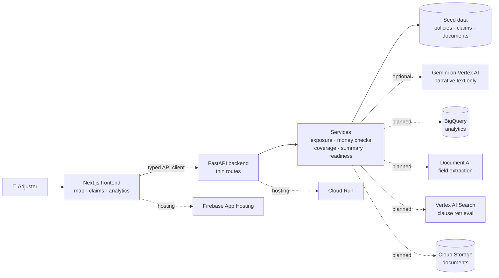

<div align="center">

# 🛡️ ClaimWise AI

### When a cyclone hits, insurers have hours to find the policies in its path, prepare their adjusters, and check the claims already in. ClaimWise does that in one screen.

**Catastrophe intelligence · Claims command center · Evidence and policy checks · Readiness planning**


</div>

---

## The problem

A catastrophe creates thousands of questions in a few hours:

- **Where** are our insured properties in the impact area, and how much value sits there?
- **What** claims are already arriving, and which ones are missing evidence?
- **Do** the amounts on the claim match the supplier's estimate, and does the policy cover this kind of loss?
- **How many** adjusters do we need, and who should we call first?

Today those answers come from spreadsheets, inboxes and experience. ClaimWise puts them in one place, with every number traceable to a record.

## What ClaimWise does

| | |
|---|---|
| 🌀 **Catastrophe intelligence** | An interactive map of hazard zones with severity, source and timestamps. Every event is labelled **SIMULATED** or **LIVE**. |
| 📍 **Exposure in seconds** | Finds insured locations inside an impact radius. Counts each policy once, however many of its locations are inside, and totals insured value. |
| 🧾 **Claims command center** | Search, filter, sort and page through claims. Filter by type, status, priority, event or adjuster. Open any claim. |
| ✅ **Evidence checklist** | Shows which documents each claim type needs and which are missing. Explains why each one matters. |
| 💰 **Deterministic money checks** | Compares the reported amount with supplier totals, the policy limit, the deductible and the policy period. A mismatch is flagged for investigation, not called fraud. |
| 📜 **Policy coverage review** | Groups clauses into *potentially covered*, *potentially excluded or restricted* and *needs human review*. Every clause shows its source. |
| 🧠 **AI claim summary** | A structured summary built from verified facts, plus a Gemini narrative when Vertex AI is configured. Falls back to a labelled template when it isn't. |
| 📋 **Readiness planner** | Expected claims, adjuster capacity and days needed, with owners, deadlines and trackable tasks. |
| ⚖️ **Human in the loop** | ClaimWise never approves, rejects or declares fraud. Every screen says **"No decision. Human adjuster review required."** |

## Architecture



**The rule behind the design:** deterministic code does the arithmetic, dates and rules. AI only explains results from verified facts. Without AI the product still computes exposure, checks amounts, and tracks evidence. The AI adds the explanation.

## Google Cloud, honestly

| Service | Role in ClaimWise | Status in this build |
|---|---|---|
| **Gemini on Vertex AI** | Claim summary and readiness narrative | ✅ Implemented. Live when `GEMINI_ENABLED=true`. Falls back to a labelled template on any failure |
| **BigQuery** | Portfolio and exposure analytics | 🟡 Schema, seed data and exposure SQL ready. Analytics run in Python for the demo |
| **Document AI** | Field extraction from invoices and estimates | 🔜 Planned. Uploads are stored but not extracted. No values are invented |
| **Vertex AI Search** | Retrieval of policy wording | 🔜 Planned. Uses the labelled DEMO POLICY DATA clause set |
| **Cloud Storage** | Storage for uploaded claim documents | 🔜 Planned. Local demo storage for now |
| **Cloud Run** | Backend hosting | 🟡 Dockerfile ready |
| **Firebase App Hosting** | Frontend hosting | 🟡 Configuration in `frontend/apphosting.yaml` |

Every integration reports its own status on the **Settings** page, so judges can see what is live and what is labelled demo.

## Demo scenarios

The seed data includes two simulated cyclones and a fire, all clearly labelled as fictional:

- **Demo Coastal Cyclone (SIMULATED)**: three insured properties in a coastal district, with three claims. One has a mock estimate that matches the claim. One is a flood motor claim that falls outside the policy's covered perils and goes to human review. One is a fire claim with a missing proof of ownership.
- **Cyclone Meera (SIMULATED)**: a larger coastal scenario with 16 exposed policies across 17 locations.
- **Industrial Fire Incident (SIMULATED)**: a localised event, for fire-claim examples.

## Try it in 3 minutes

```bash
# 1. Backend (Python 3.10+)
cd backend
python3 -m venv .venv
.venv/bin/pip install -r requirements.txt
.venv/bin/uvicorn app.main:app --port 8000

# 2. Frontend (new terminal)
cd frontend
npm install
npm run dev
```

Open **http://localhost:3000**, then follow the walkthrough:

1. **Overview**: the KPIs and the active cyclone.
2. **Catastrophe Intelligence**: select *Demo Coastal Cyclone*. Watch the impact circle and insured locations appear, with the exposure breakdown below the map.
3. **Claims Command Center**: filter by property damage, open **CLM-2001**.
4. **Claim detail**: check the document checklist, then the **Financial validation** tab, where the mock invoice shows a discrepancy to investigate.
5. **Policy coverage**: see the clauses grouped into covered, excluded and needs review, each with its source.
6. **AI summary** and **Readiness Planner**: generate a plan and update a task.

API docs are at **http://localhost:8000/docs**.

Run the checks:

```bash
cd backend && .venv/bin/python -m pytest -q     # 28 tests
cd frontend && npm run build                    # production build
```

## Under the hood

- **28 backend tests** cover exposure counting, distinct policy totals, policy limits, deductibles, missing documents, contradictory totals, upload validation, unknown IDs, status updates, the AI fallback and readiness generation.
- **Uploads are treated as untrusted.** Files are checked for type, size and file signature. They're stored under generated names, never the client's file name.
- **No secrets in the repo.** Credentials stay in environment variables and the Cloud Run service account. Frontend code never sees them.
- **Responsible AI by design.** AI output is validated before display. Any fallback is labelled. Coverage returns `not_determined`.

## Repository

```
backend/       FastAPI app, services, seed data, tests, Dockerfile
frontend/      Next.js app: map, claims, analytics, readiness, settings
infrastructure/bigquery/   schema, exposure query, synthetic seed files
docs/          architecture, API reference, Google Cloud setup, demo script
```

Docs: [Architecture](docs/ARCHITECTURE.md) · [API reference](docs/API.md) · [Google Cloud setup](docs/GOOGLE_CLOUD_SETUP.md) · [Demo script](docs/DEMO_SCRIPT.md)

## Limitations

- All data is **synthetic**. Simulated alerts are not official warnings or forecasts.
- Being in an impact area is not evidence of damage, and coverage depends on the actual wording, endorsements and facts.
- The impact area is a radius approximation, not a verified meteorological boundary.
- Changes made in the app are held in memory and reset when the server restarts.
- Document AI, Vertex AI Search and Cloud Storage are planned, not yet connected.

---

<div align="center">

**ClaimWise AI** helps insurers move from catastrophe awareness to claims readiness, using Google Cloud AI and analytics, while people make every decision.

</div>
